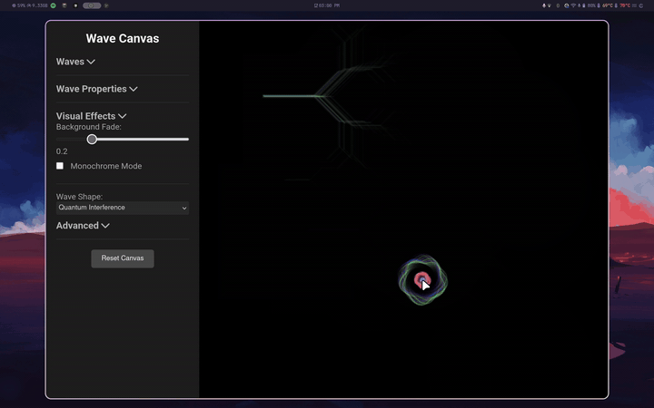

# 🌊 Wave Canvas

An interactive, real-time wave playground. Click anywhere on the canvas and watch ripples spread, collide, and paint themselves across the screen — or let **Auto Visualizer** run the show.


[Try it live](https://ftbhabuk.github.io/wave_animate/)



## Features

- **13 wave shapes** — from plain circles to cosmic mandalas, quantum interference, fractal dendrites, and fireworks
- **Every wave spawns with a random vibrant color** — or switch to monochrome for a clean white look
- **Collision physics** — incoming rings slow and dim when they meet waves from a different origin
- **Trail / ghosting effect** with adjustable persistence
- **Auto Visualizer** — randomness on autopilot: it clicks, cycles shapes, drifts all settings, and even animates the sidebar sliders as it goes
- **Zero dependencies** — pure vanilla JS + Canvas; no build step

## Controls

| Control | Description | Range |
|---------|-------------|-------|
| Wave Spread | Dispersion radius of multi-wave splashes | 0.0 – 10.0 |
| Number of Waves | Waves emitted per splash | 1 – 5 |
| Wave Delay | Stagger between emitted waves | 0 – 500 ms |
| Wave Speed | Ring expansion rate | 1 – 2 |
| Wave Strength | Intensity & lifetime | 0.1 – 2.0 |
| Background Fade | Trail persistence | 0.1 – 0.5 |
| Gravity Intensity | Droplet arc gravity | 0.5 – 1.5 |
| Trail Effect | Ghosting on/off | toggle |
| Monochrome | All-white waves | toggle |
| Random Shapes | Random shape per manual click | toggle |
| Auto Visualizer | Fully automated sessions | toggle |

## Keyboard

| Key | Action |
| --- | --- |
| `S` | Cycle to the next wave shape |

## Getting Started

```bash
git clone https://github.com/ftbhabuk/wave_animate.git
cd wave_animate
```

Open `index.html` in any browser — nothing to install or build.

## Wave Shape Gallery

- **Basic** — Circle, Square, Triangle
- **Organic** — Mandala, Spiral, Fractal
- **Exotic** — Cosmic Mandala, Fractal Dendrite, Quantum Interference, Ethereal Plasma, Quantum Singularity, Fractal Consciousness, Fireworks

## Built With

- **Vanilla JavaScript** — no frameworks
- **HTML5 Canvas** — hardware-accelerated rendering
- **CSS3** — dark sidebar UI